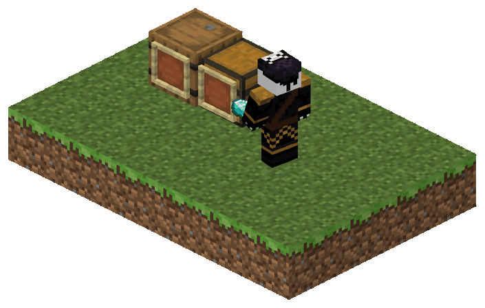
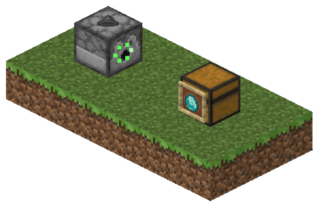
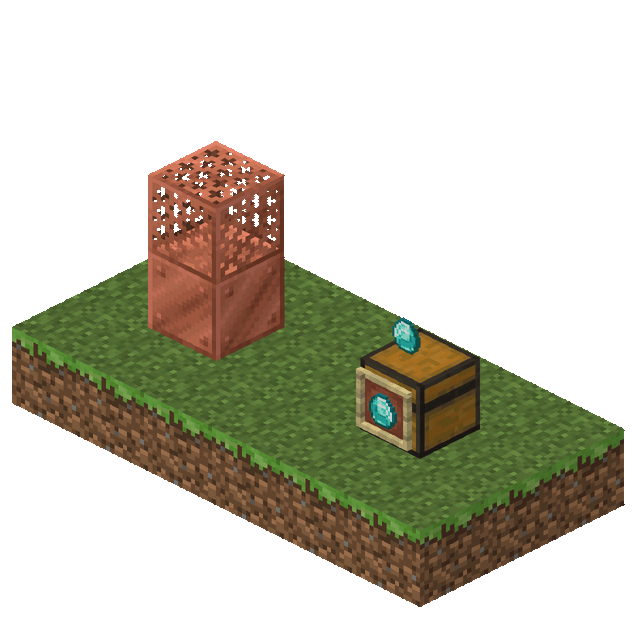
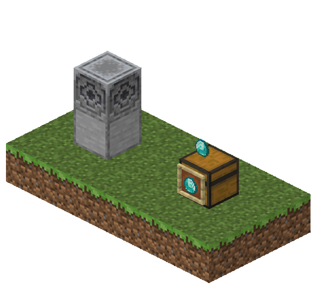
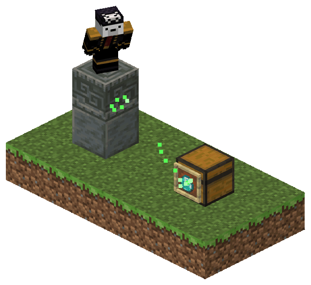
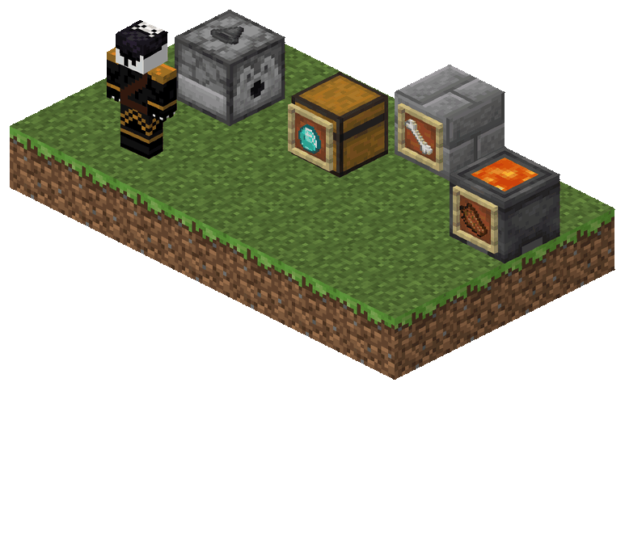

# FrameSort

Item sorting without hopper chains. A **sorter** (a dispenser with a hopper in an item frame on it) and **sorting
pads** (a waxed copper grate on a waxed block of copper, a lodestone on smooth stone, or chiseled tuff on
polished tuff) send items straight to the **target frames** that ask for them: into the chest, barrel or hopper
behind the frame, composted by a composter, or dropped in front of the frame when there is no container.

- **Server:** Paper 26.2 or newer, Java 25.
- **Dependencies:** none. With [WorldGuard](https://enginehub.org/worldguard) installed, sorters and pads respect its
  regions; with [CraftEngine](https://github.com/Xiao-MoMi/craft-engine) installed, its custom items are sorted by
  their ID (see below).
- **Storage:** none to set up. Targets, pads and items keep their data in the world, and each player's
  `/framesort automark` choice is kept with the player (persistent data containers); who trusts whom is in
  `plugins/FrameSort/data.db` (SQLite), or in MySQL or MariaDB to share it between servers (`database.yml`).

## Installation

1. Put `FrameSort-<version>.jar` in the server's `plugins/` folder.
2. Start the server once. FrameSort writes `config.yml`, `pads.yml`, `tags.yml`, `commands.yml`, `database.yml` and
   the language file in use (`lang/en_US.yml`) to `plugins/FrameSort/`, and downloads HikariCP and the MariaDB driver
   on that first start.
3. Edit them and run `/framesort reload` (`commands.yml` and `database.yml` need a restart).

`/version FrameSort` shows the installed version.

When the server stops, every sorter in a loaded chunk shows its frame again. A sorter in a chunk that isn't loaded
keeps its hidden frame until it loads with FrameSort installed, so before removing FrameSort, take the activator
(the hopper) out of those sorters.

## How it works

1. **Targets.** Put an item in a frame on a container and sneak + right-click the frame with an empty hand to
   mark it as a target: it glows and the action bar says so. With `/framesort automark` on, putting the item in is
   enough. The mark goes with that item: putting another one in leaves the frame unmarked, or, with automark,
   marked for whoever put it in. A frame accepts items in this order of preference:
   1. the exact item;
   2. a tag, when the frame item has one applied (`/framesort tag apply <tag>`): a game tag, or one of your own in
      `tags.yml`;
   3. the same material.

   A shulker box or bundle in the frame stands for what it holds, never for itself, and each of those matches
   ranks just below the same match made directly; to keep shulker boxes or bundles whole, put an empty one in the
   frame: it takes any of its kind. Among targets that want it as much, the nearest fills first; when the preferred
   targets are full, the rest goes to the next ones. A frame holding a recovery compass comes last: it takes whatever
   matches nothing else, and whatever the other targets have no room for. A frame on a lava cauldron destroys
   leftovers.

   

2. **Sorters.** Put a hopper in a frame on a dispenser. The frame disappears and every second the dispenser
   sends up to 64 items from its inventory, at random, taking them from inside shulker boxes and bundles too. A
   shulker box or bundle goes whole once nothing inside it can go anywhere.

   

3. **Sorting pads.** Place a waxed copper grate on a waxed block of copper, or a lodestone on smooth stone. Items
   resting on top, or lying loose within a few blocks (the pad pulls them in), are sent to targets. Chiseled tuff
   on polished tuff makes a pad that sends your inventory, a stack at a time, while you crouch on it (not the
   hotbar, armour or off hand). Who can create pads is configurable: anyone, players with a permission, or only with
   a special pad block.

   
   
   

4. **Inspect.** Sneak + right-click a sorter or pad with an empty hand: its targets' items glow (only for you, in
   configurable colours) and are listed page by page. Sneak + left-click a target frame to see what it accepts.
   `/framesort trace` shows the deliveries around you live.

   

5. **Owners and trust.** What you set up is yours: the frames you mark, the sorters you put the activator in, the
   pads you build. Your sorters and pads send only to your frames, so nobody can mark a frame near them and take
   your items, and only you, the players you trust and admins see where they send.
   `/framesort trust <player>` makes that player's frames count as yours for your sorters and pads, one way: a team
   trusts each other. Breaking blocks or opening chests is still up to the server's protection. See
   [docs/commands.md](docs/commands.md#owners-and-trust).

**WorldGuard.** When it is installed, a sorter or pad only sends to target frames on blocks in exactly the same
regions as itself, whether they hold a container, a drop spot or lava, and a pad only pulls items lying in those
regions; both outside every region is fine. Nobody can
fill a chest in a region from outside it, or from another region. Inspecting a sorter or pad lists only the targets
it can reach. Targets are cached, so after changing regions run `/framesort reload`.

**CraftEngine.** When it is installed, a custom item counts as itself, never as the vanilla material it is made of
(many custom items share one). Where a frame would take the same material, a custom item in it takes the same
custom item instead, whatever its durability, name or random values; vanilla items of that material don't go there,
and a custom item never goes to a frame for its material. No game tag takes a custom item; a tag in `tags.yml` takes
the ones it lists, written as inspecting a frame that holds the item shows them (`craftengine:default:topaz_axe`). A
custom item in a frame is never the default target, even one made from a recovery compass, nor the sorter activator,
even one made from a hopper, unless the config names that custom item
(`activator.material: 'craftengine:default:ruby'`, and the same in `default-target-item`). A pad's blocks can be
CraftEngine blocks too, named the same way in `pads.yml`; otherwise a CraftEngine block never counts as a vanilla one.
A frame on a CraftEngine storage block or drawer fills it as a hopper would. What FrameSort hands out (the activator,
a pad block) shows its name and lore instead of CraftEngine's, if set. The ID is read from each item, so `/ce reload`
changes nothing for items; a pad made of CraftEngine blocks waits until the reload ends, and in `item` mode it can't
be broken meanwhile, so its item is never lost.

Containers are looked up the moment items go in, so a container that was moved or broken is skipped: items are
never duplicated.

## Commands

| Command | Permission | Default |
|---|---|---|
| `/framesort` (help) | `framesort.command.help` | everyone |
| `/framesort automark` | `framesort.command.automark` | everyone |
| `/framesort tag list [page]` | `framesort.command.tag-list` | everyone |
| `/framesort tag search <text> [page]` | `framesort.command.tag-search` | everyone |
| `/framesort tag show <tag> [page]` | `framesort.command.tag-show` | everyone |
| `/framesort tag apply <tag>` | `framesort.command.tag-apply` | everyone |
| `/framesort tag remove` | `framesort.command.tag-remove` | everyone |
| `/framesort where` | `framesort.command.where` | everyone |
| `/framesort trace [seconds\|stop]` | `framesort.command.trace` | everyone |
| `/framesort trust <player>` | `framesort.command.trust` | everyone |
| `/framesort untrust <player>` | `framesort.command.untrust` | everyone |
| `/framesort trusted [page]` | `framesort.command.trusted` | everyone |
| `/framesort give sorter\|pad <type> [player] [amount]` | `framesort.command.give` | op |
| `/framesort reload` | `framesort.command.reload` | op |

The three trust commands only exist while `ownership.enabled` is on.

Every command also runs as `/fs`. Where each command lives, its permission and whether it is enabled are set in
`commands.yml`; see [docs/commands.md](docs/commands.md). The help lists only the commands the player may run.

## Permissions

| Permission | Default | Grants |
|---|---|---|
| `framesort.*` | op | everything |
| `framesort.use` | everyone | inspecting, marking targets and the help, automark, tag, where, trace, trust, untrust and trusted commands (every `framesort.command.tag-*`) |
| `framesort.admin` | op | creating pads in `permission` mode, inspecting anyone's sorters and pads, and the give and reload commands |
| `framesort.inspect` | everyone | inspecting sorters, pads and frames |
| `framesort.inspect.others` | op | inspecting and tracing sorters and pads whose owner doesn't trust you |
| `framesort.target.create` | everyone | marking frames as targets, by hand (with `framesort.inspect`) or with automark |
| `framesort.pad.create` | op | creating pads when `pads.yml` has `creation: permission` |
| `framesort.command.<command>` | as in the table above | each command |

## Configuration

`config.yml` (sorters, targets, delivery, ownership, inspection), `pads.yml` (pad types and who can create them),
`tags.yml` (tags of your own and replacements for the game's), `database.yml` (where trust is kept) and `lang/`.
See [docs/configuration.md](docs/configuration.md).

## Build

```bash
./gradlew build
```

Needs nothing installed beyond a JDK: Gradle downloads Java 25 if it is missing. The jar is written to
`build/libs/`, and `./gradlew runServer` starts a Paper 26.2 test server with it. How the plugin is put together
(packages, stored data, threads) is in [docs/development.md](docs/development.md).

## License

FrameSort is free software under the GNU General Public License v3.0 only (`GPL-3.0-only`); see
[LICENSE](LICENSE).
