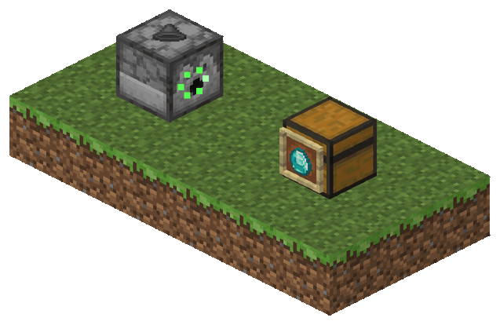
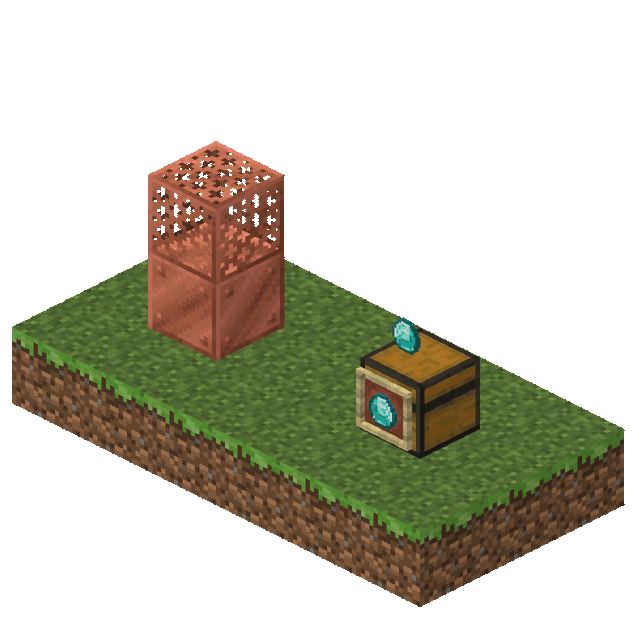
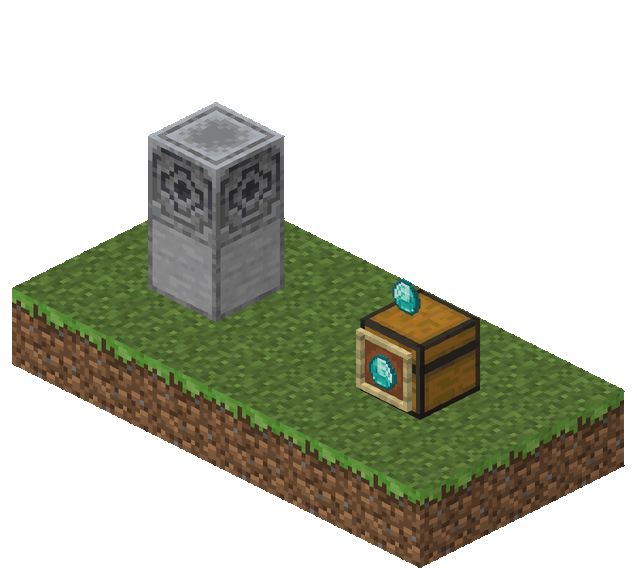
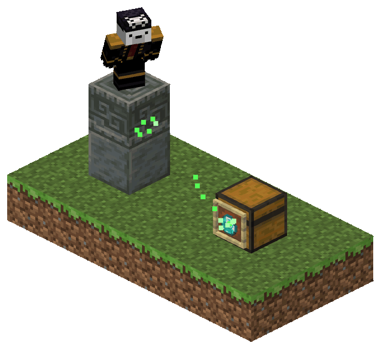
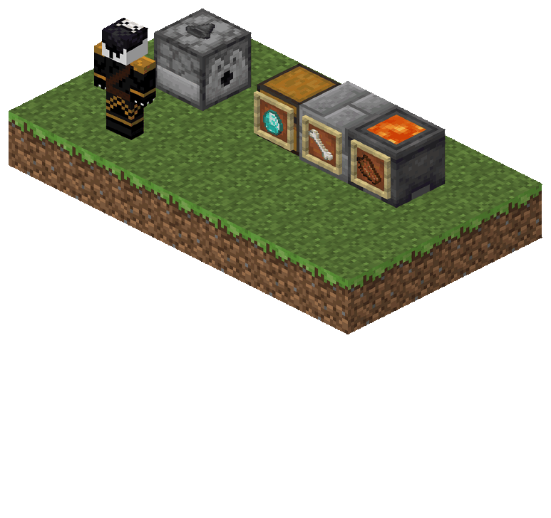

# FrameSort

Item sorting without hopper chains. A **sorter** (a dispenser with a hopper in an item frame on it) and **sorting
pads** (a waxed copper grate on a waxed block of copper, a lodestone on smooth stone, or chiseled tuff on
polished tuff) send items straight to the **target frames** that ask for them: into the chest, barrel, shulker box,
hopper, dispenser or dropper behind the frame, composted by a composter, or dropped in front of the frame on any
other block.

- **Server:** Paper 26.2 – 26.3 (checked on 26.2 build 135 and 26.3 build 226), Java 25.
- **Dependencies:** none. With [WorldGuard](https://enginehub.org/worldguard) installed, sorters and pads respect its
  regions; with [CraftEngine](https://github.com/Xiao-MoMi/craft-engine) installed, its custom items are sorted by
  their ID (see below).
- **Storage:** none to set up. Targets, pads and items keep their data in the world, and each player's
  `/framesort automark` choice is kept with the player (persistent data containers); who trusts whom is in
  `plugins/FrameSort/data.db` (SQLite), or in MySQL or MariaDB to share it between servers (`database.yml`).

## Installation

1. Put `FrameSort-<version>.jar` in the server's `plugins/` folder.
2. Start the server once. FrameSort writes `config.yml`, `pads.yml`, `tags.yml`, `commands.yml`, `database.yml` and
   the language file in use (`lang/en_US.yml`) to `plugins/FrameSort/`, and downloads HikariCP and the MariaDB driver
   on that first start. bStats, inside the jar, writes `plugins/bStats/config.yml` if no other plugin has (see
   [Metrics](#metrics)).
3. Edit them and run `/framesort reload` (`commands.yml` and `database.yml` need a restart).

`/version FrameSort` shows the installed version.

When the server stops, every sorter in a loaded chunk shows its frame again. A sorter in a chunk that isn't loaded
keeps its hidden frame until it loads with FrameSort installed, so before removing FrameSort, take the activator
(the hopper) out of those sorters.

## How it works

1. **Targets.** Put an item in a frame on a container and sneak + right-click the frame with an empty hand to
   mark it as a target: it glows and the action bar says so. With `/framesort automark` on, putting the item in is
   enough. Marking works only within range of a sorter or pad of yours, or of a player who trusts you, so put that
   up first; elsewhere sneak-clicks on a frame that isn't a target stay vanilla. The mark goes with that item:
   taking it out unmarks the frame, and by hand the action bar says so; the next item put in leaves it unmarked, or,
   with automark, marks it for whoever put it in. A frame accepts items in this order of preference:
   1. the exact item;
   2. a tag, when the frame item has one applied (`/framesort tag apply <tag>`): a game tag, or one of your own in
      `tags.yml`;
   3. the same material.

   A shulker box or bundle in the frame stands for what it holds, never for itself, and each of those matches
   ranks just below the same match made directly; to keep shulker boxes or bundles whole, put an empty one in the
   frame: it takes any of its kind. Among targets that want it as much, the nearest fills first; when the preferred
   targets are full, the rest goes to the next ones. A frame holding a recovery compass comes last: it takes whatever
   matches nothing else, and whatever the other targets have no room for. A frame on a lava cauldron destroys
   leftovers.

   
   

2. **Sorters.** Put a hopper in a frame on a dispenser. The frame disappears and every second the dispenser
   sends up to 64 items from its inventory, at random, taking them from inside shulker boxes and bundles too. A
   shulker box or bundle goes whole once nothing inside it can go anywhere.

   

3. **Sorting pads.** Place a waxed copper grate on a waxed block of copper, or a lodestone on smooth stone. Items
   resting on top, or lying loose within a few blocks (the pad pulls them in), are sent to targets. Chiseled tuff
   on polished tuff makes a pad that sends your inventory, a stack at a time, while you crouch on it (not the
   hotbar, armour or off hand). Who can create pads is configurable: anyone, players with a permission, or only with
   a special pad block.

   
   
   

4. **Inspect.** Sneak + right-click a sorter or pad with an empty hand: its targets' items glow (only for you, in
   configurable colours) and are listed page by page; hovering one shows where it is, how far and how full. Sneak +
   left-click a target frame to see what it accepts.
   `/framesort trace` shows the deliveries around you live.

   

5. **Owners and trust.** What you set up is yours: the frames you mark, the sorters you put the activator in, the
   pads you build. Your sorters and pads send only to your frames, so nobody can mark a frame near them and take
   your items, and only you, the players you trust and admins see where they send.
   `/framesort trust <player>` makes that player's frames count as yours for your sorters and pads, one way: a team
   trusts each other. Breaking blocks or opening chests is still up to the server's protection. See
   [docs/commands.md](docs/commands.md#owners-and-trust).

**WorldGuard.** When it is installed, sorters and pads follow WorldGuard's rule for pistons: they count as members of
the regions they stand in, and send or pull only where such a member could build. So a chest in a region only takes
from sorters and pads inside it or its parent regions, unless the region says otherwise with its `build` flag or
FrameSort's own flags, `framesort-deliver` and `framesort-pull`. Inspecting a sorter or pad lists only the targets it
can reach. See [docs/configuration.md](docs/configuration.md#worldguard-regions).

**CraftEngine.** When it is installed, a custom item counts as itself, never as the vanilla material it is made of
(many custom items share one). Where a frame would take the same material, a custom item in it takes the same
custom item instead, whatever its durability, name or random values; vanilla items of that material don't go there,
and a custom item never goes to a frame for its material. No game tag takes a custom item; a tag in `tags.yml` takes
the ones it lists, written as the card of a target frame holding the item shows them
(`craftengine:default:topaz_axe`). A
custom item in a frame is never the default target, even one made from a recovery compass, nor the sorter activator,
even one made from a hopper, unless the config names that custom item
(`activator.material: 'craftengine:default:ruby'`, and the same in `default-target-item`). A pad's blocks can be
CraftEngine blocks too, named the same way in `pads.yml`; otherwise a CraftEngine block never counts as a vanilla one.
A frame on a CraftEngine storage block or drawer fills it as a hopper would. What FrameSort hands out (the activator,
a pad block) shows its name and lore instead of CraftEngine's, if set. The ID is read from each item, so `/ce reload`
changes nothing for items; a pad made of CraftEngine blocks waits until the reload ends, and in `item` mode it can't
be broken meanwhile, so its item is never lost.

Containers are looked up the moment items go in, so a container that was moved or broken is skipped: items are
never duplicated.

## Commands

| Command | Permission | Default |
|---|---|---|
| `/framesort [page]` (help) | `framesort.command.help` | everyone |
| `/framesort automark` | `framesort.command.automark` | everyone |
| `/framesort tag list [page]` | `framesort.command.tag-list` | everyone |
| `/framesort tag search <text> [page]` | `framesort.command.tag-search` | everyone |
| `/framesort tag show <tag> [page]` | `framesort.command.tag-show` | everyone |
| `/framesort tag apply <tag>` | `framesort.command.tag-apply` | everyone |
| `/framesort tag remove` | `framesort.command.tag-remove` | everyone |
| `/framesort where` | `framesort.command.where` | everyone |
| `/framesort trace [seconds\|stop]` | `framesort.command.trace` | everyone |
| `/framesort trust <player>` | `framesort.command.trust` | everyone |
| `/framesort untrust <player>` | `framesort.command.untrust` | everyone |
| `/framesort trusted [page]` | `framesort.command.trusted` | everyone |
| `/framesort give sorter\|pad <type> [player] [amount]` | `framesort.command.give` | op |
| `/framesort reload` | `framesort.command.reload` | op |

The three trust commands only exist while `ownership.enabled` is on.

Every command also runs as `/fs`. Where each command lives, its permission and whether it is enabled are set in
`commands.yml`; see [docs/commands.md](docs/commands.md). The help lists only the commands the player may run.

## Permissions

| Permission | Default | Grants |
|---|---|---|
| `framesort.*` | op | everything |
| `framesort.use` | everyone | inspecting, marking targets and the help, automark, tag, where, trace, trust, untrust and trusted commands (every `framesort.command.tag-*`) |
| `framesort.admin` | op | creating pads in `permission` mode, inspecting anyone's sorters and pads, and the give and reload commands |
| `framesort.inspect` | everyone | inspecting sorters, pads and frames |
| `framesort.inspect.others` | op | inspecting and tracing sorters and pads whose owner doesn't trust you, and marking frames near them |
| `framesort.target.create` | everyone | marking frames as targets, by hand (with `framesort.inspect`) or with automark |
| `framesort.pad.create` | op | creating pads when `pads.yml` has `creation: permission` |
| `framesort.command.<command>` | as in the table above | each command |

## Configuration

`config.yml` (worlds to leave out, sorters, targets, delivery, ownership, inspection), `pads.yml` (pad types and who
can create them), `tags.yml` (tags of your own and replacements for the game's), `database.yml` (where trust is kept)
and `lang/`. See [docs/configuration.md](docs/configuration.md).

## Metrics

FrameSort sends usage statistics to
[bStats](https://bstats.org/plugin/bukkit/FrameSort/35215),
which shows them publicly: how many players are online, whether the server runs in online mode, the server software
and its version, the Java version, the operating system (name, architecture and version), the number of CPU cores,
the FrameSort version, a random ID bStats gives the server, and the country, which bStats works out itself. Nothing
else: no player names, and nothing about your worlds. The first send is 3 to 6 minutes after the server starts, then
one every 30 minutes.

To turn them off, set `enabled: false` in `plugins/bStats/config.yml`. Every plugin that uses bStats reads that file,
so this turns bStats off for all of them; FrameSort has no setting of its own. `logSentData: true` in the same file
prints each send in the console.

## Performance

A server has 50 ms for each tick. On a large test server (50 sorters, 100 pads, 2000 chests with target frames),
measured with [spark](https://spark.lucko.me), FrameSort used under 1 ms of them while sorting non-stop, and 9 ms with
every chest full and every sorter still trying. At four times that size it holds too, except when all the sorters are
stuck on full chests at once: that takes 110 ms a tick. Results, screenshots and how to check it on your own server are
in [docs/performance.md](docs/performance.md).

## Build

```bash
./gradlew build
```

Needs nothing installed beyond a JDK: Gradle downloads Java 25 if it is missing. The jar is written to
`plugin/build/libs/`. `./gradlew runServer` starts a Paper 26.3 test server with it, and `./gradlew runServerMinimum` a
Paper 26.2 one. How the plugin is put together (packages, stored data, threads) is in
[docs/development.md](docs/development.md).

## License

FrameSort is free software under the GNU General Public License v3.0 only (`GPL-3.0-only`); see
[LICENSE](LICENSE). The jar bundles [bStats Metrics](https://github.com/Bastian/bStats-Metrics) under the MIT License,
whose text is in `META-INF/licenses/bstats.txt` inside the jar.
