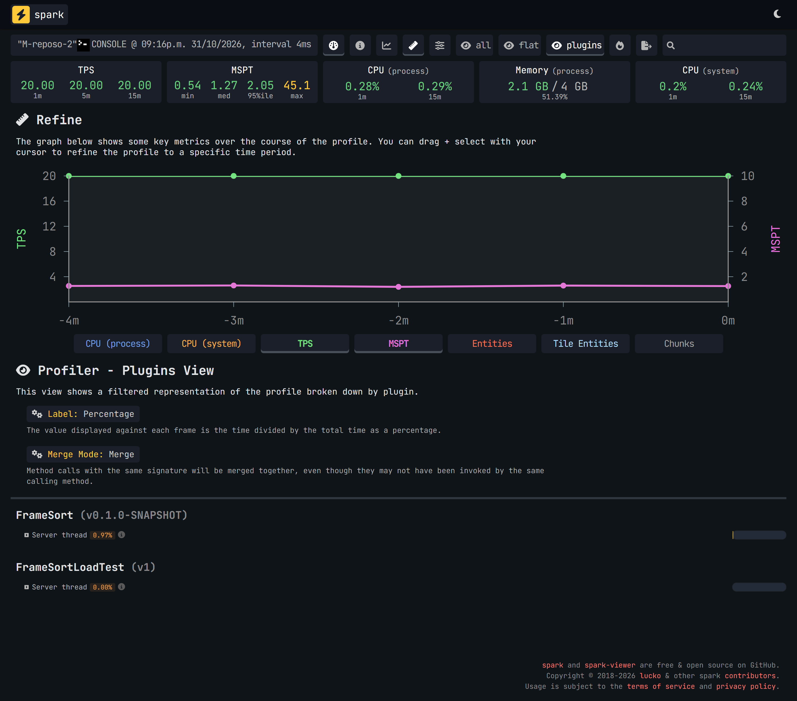
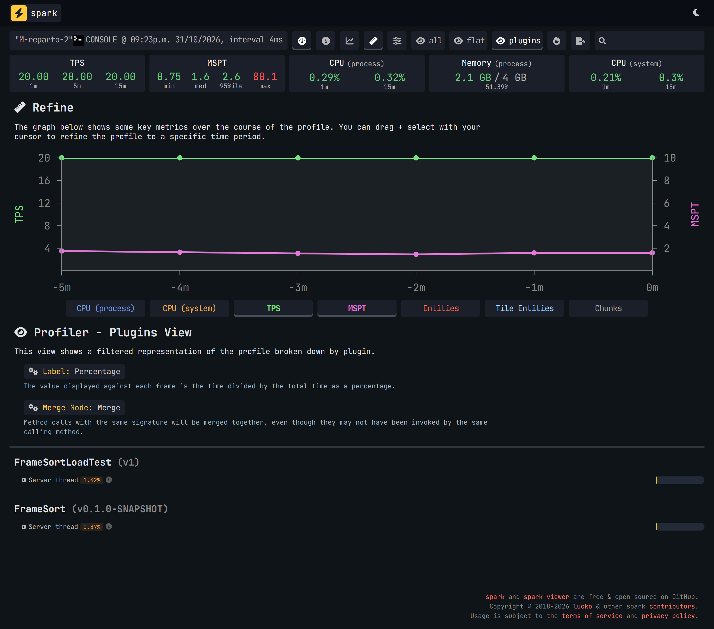
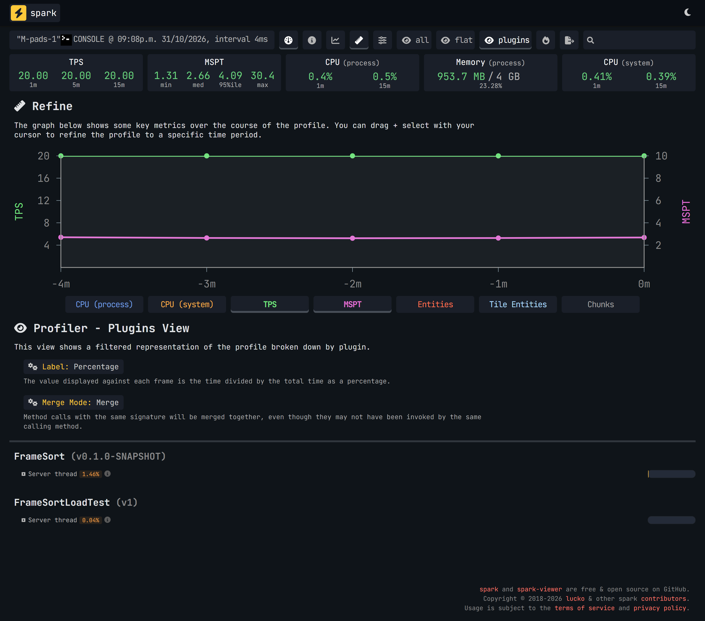
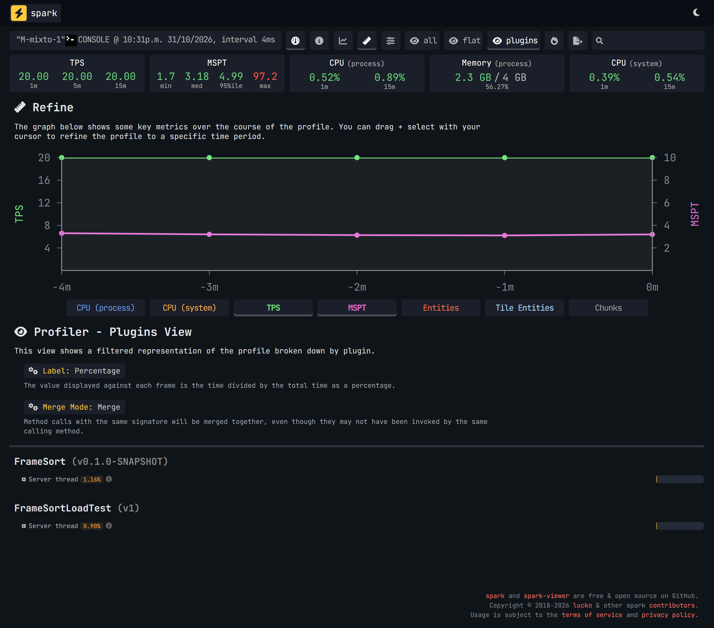
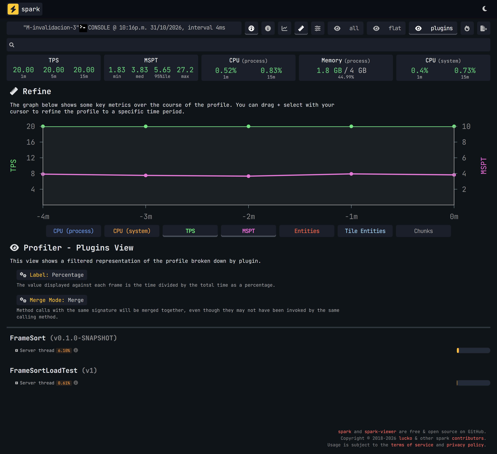
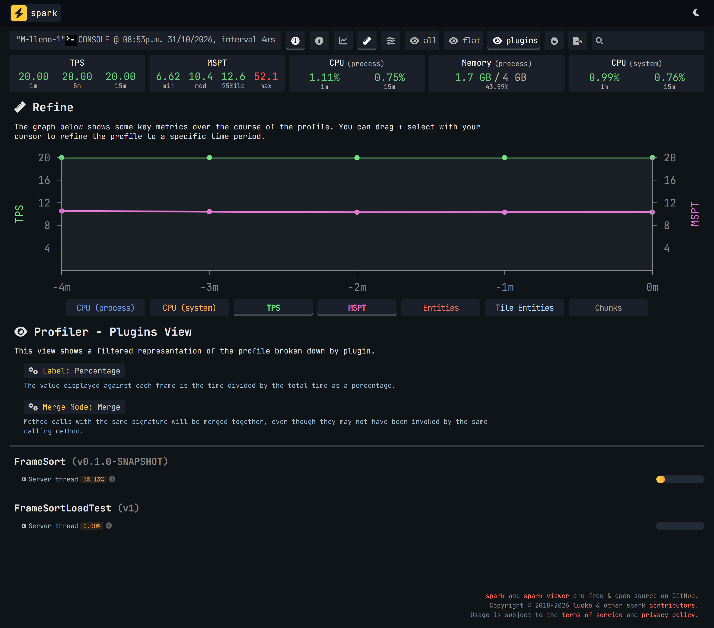
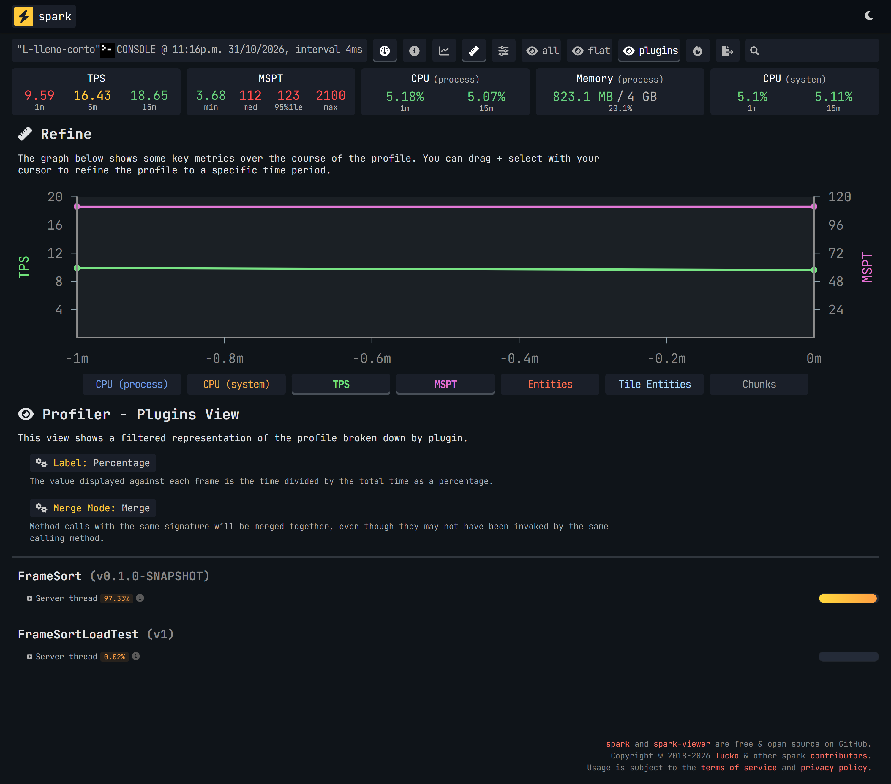

# Performance

On a large test server (50 sorters, 100 sorting pads, 2000 chests with target frames), FrameSort used under 1 ms out
of the 50 ms each server tick has while sorting non-stop, and 9 ms in the worst case tested: every chest full and
every sorter still trying. The server held 20 TPS in every test at that size.

| What the server was doing | FrameSort's time per tick | Share of the 50 ms |
|---|---|---|
| Everything built, nothing to sort | 0.5 ms | 1% |
| Sorters sending items non-stop | 0.4 ms | 1% |
| Pads collecting 200 items a second | 0.7 ms | 1.5% |
| Sorters and pads working at once | 0.6 ms | 1% |
| Sorters sending non-stop while a target frame is added or removed every second | 3 ms | 6% |
| Every chest full, every sorter still trying | 9 ms | 18% |

Measured on 2026-10-31 with FrameSort 0.1.0 (development build) on Paper 26.3. These are measurements of one test
machine, not a promise about your server: see [what this doesn't cover](#what-this-doesnt-cover).

## What these numbers mean

A Minecraft server does all its work in **ticks**, 20 times a second, so it has 50 milliseconds (ms) for each one. As
long as every tick fits in those 50 ms the server runs at a full 20 **TPS** (ticks per second). When ticks take longer,
TPS drops and players feel it as lag.

So "FrameSort uses 3 ms" means 3 of those 50 ms go to FrameSort, and the other 47 are left for everything else.

The figures come from [spark](https://spark.lucko.me), the profiler that comes with Paper, which shows what is slowing
a server down.

## The tests

The test world is built to be harder than a normal server:

- **Everything reaches everything.** All chests are within the default `range` of 64 blocks of all sorters and pads, so
  each one has every chest for its item to consider. A real base spread over several areas has fewer.
- **The sorters never rest.** Each sends its full 64 items every second, which at this size is 3200 items a second.
  The chests are emptied all the time, so they always have room, except in the test where they are full on purpose.
- **32 kinds of item,** so about 62 chests for each kind.

Each test ran for 5 minutes after 2 minutes of warm-up, three times, and the table shows the middle result.

Each screenshot is spark's page for one of those runs. To read one:

- **MSPT** at the top is how long ticks took: `med` is the typical tick and `95%ile` a slow one (only 1 tick in 20 was
  slower). This is the whole server, not just FrameSort.
- **The `FrameSort` row** under *Profiler - Plugins* is FrameSort's share of the server's main thread. Multiply it by
  50 ms to get its time per tick: 1.46% is about 0.7 ms.
- **`FrameSortLoadTest`** is the small plugin that builds the test world and keeps feeding it. It isn't part of
  FrameSort.
- **The label at the top left** is the run's internal name: `M` is the large size and `L` four times that size.

### Everything built, nothing to sort

FrameSort only checks whether there is anything to do. The typical tick took 1.3 ms, against 1.1 ms without FrameSort.

These figures are so small that they jump around between runs: from 0.1 to 0.8 ms here, while the typical tick stayed
between 1.26 and 1.28 ms.



*`med` shows 1.27 ms for the whole tick, and FrameSort's row shows 0.97%, which is about 0.5 ms.*

### Sorters sending items non-stop

A typical tick took 1.6 ms, against 1.4 ms without FrameSort. FrameSort remembers which frames want each item, so each
delivery goes straight to its chest and stops as soon as everything has fit. Runs measured from 0.2 to 0.6 ms.



*`med` shows 1.6 ms, and FrameSort's row 0.87%, about 0.4 ms. `FrameSortLoadTest` is higher than FrameSort here:
refilling and emptying chests costs more than sorting.*

### Pads collecting items

200 items a second land around the pads, and they are sent to chests. Here the server runs **lighter with FrameSort
than without it**: the typical tick took 2.8 ms with it and 5.2 ms without, because items leave the ground instead of
piling up. About 470 items were left lying around at the end, against about 2070 without FrameSort. Runs measured from
0.7 to 0.8 ms.



*`med` shows 2.66 ms, and FrameSort's row 1.46%, about 0.7 ms.*

### Sorters and pads at once

The closest test to a real busy server. A typical tick took 3.2 ms and a slow one 5 ms. This one ran once.



*`med` shows 3.18 ms, `95%ile` 4.99 ms, and FrameSort's row 1.16%, about 0.6 ms.*

### A target frame added or removed every second

Each time a target frame appears or goes, or its chunk loads or unloads, FrameSort forgets what it remembered about
that world and looks it up again at the next delivery. Doing that every second, with every sorter busy, is exaggerated
on purpose. A typical tick took 3.8 ms, against 1.4 ms without FrameSort. Runs measured from 2.9 to 3.2 ms, and no tick
went over 50 ms.



*`med` shows 3.83 ms, `max` stays under 50 ms at 27.2, and FrameSort's row shows 6.10%, about 3 ms.*

### Every chest full, every sorter still trying

This is the worst case. With nowhere to put its items, each sorter checks every chest for its item, every second, in
case one has room. A typical tick took 10.3 ms, against 0.9 ms without FrameSort. Runs measured from 8.7 to 9.1 ms.



*`med` shows 10.4 ms and TPS stays at 20.00, with FrameSort's row at 18.13%, about 9 ms. `max` is the one slow tick
of the run.*

### Slow ticks

In these tests at most one tick in each 5-minute run went over 50 ms, and it happens without FrameSort too. A profile
of one such tick showed most of its time going to the server saving data, not to FrameSort, so the likely cause is the
autosave, which runs every 5 minutes. That is a reading of the profile, not something proven. With every chest full,
FrameSort's own 9 ms do add to that tick, whose worst case here was 52 ms.

## How far it goes

The same tests also ran once at four times the size, which is far beyond a normal server: 200 sorters, 400 pads and
8000 chests, about 250 chests for each kind of item.

| What the server was doing | FrameSort's time per tick | Typical whole tick | Ticks over 50 ms |
|---|---|---|---|
| Everything built, nothing to sort | 1 ms | 4.2 ms | 2 of 6000 |
| Sorters sending items non-stop | 1.5 ms | 5.4 ms | 1 of 6000 |
| Pads collecting 200 items a second | 2.8 ms | 5.9 ms | 2 of 6000 |
| Sorters and pads working at once | 3.2 ms | 7.4 ms | 2 of 6000 |
| Sorters sending non-stop while a target frame is added or removed every second | 21 ms | 24 ms | 1 of 6000 |
| **Every chest full, every sorter still trying** | **110 ms** | **113 ms** | **All of them** |

**That last row is where FrameSort doesn't hold.** Each tick takes more than twice its 50 ms, and the server drops to
about 9 TPS. It only happens when all those sorters are stuck at the same time, each with 250 full chests to check.

The cost of that case grows with **the number of stuck sorters times the full chests each one has to check**, at about
0.003 ms for each pair. That uses up the whole 50 ms at about 17,000 pairs, for example 100 sorters stuck at once with
170 full chests each. This figure comes from the two sizes tested, so take it as a rough guide.

If your server gets near that, these settings cut the work, though they weren't measured:

- a lower `range`, so each sorter has fewer chests to check;
- a higher `tick-rate`, so each sorter tries less often;
- `disable-when-powered`, to switch off sorters you aren't using.

They're described in [configuration.md](configuration.md).



*The all-full test. TPS for `1m` shows 9.59, `med` 112 ms, and FrameSort's row 97.33%. When ticks go over 50 ms,
multiply the percentage by the typical tick instead of by 50: about 110 ms. The 2100 ms `max` and the higher TPS for
`5m` and `15m` come from before this test started: the slowest tick during it took 130 ms.*


*The sorting test. `med` shows 5.4 ms, and FrameSort's row 2.92%, about 1.5 ms.*


## Memory

FrameSort remembers which frames want each item, and that takes server memory:

- **At the large size,** about 10 MB. This is calculated from the measurement below, not measured.
- **At four times the size,** with sorters and pads at once, about 120 MB, measured.
- **It can't grow past about 220 MB.** If it reaches that, FrameSort forgets everything and starts remembering again.

While sorting non-stop at the large size, FrameSort creates and discards about 1 MB of short-lived data a second, which
the server cleans up as usual.

## How it was measured

- **Machine:** a laptop with an Intel Core i7-13700H, running Ubuntu 24.04 under WSL2, with 4 GB of memory for the
  server. Nothing else was in use during the runs.
- **Server:** Paper 26.3 build 226, Java 25, a flat world, and only FrameSort and the test plugin installed.
- **Figures:** spark's share of the main thread × 50 ms, from the middle of three runs at the large size, and from
  one run at four times the size.
- **"Without FrameSort":** the same world and load with FrameSort removed, one run of each test.

## What this doesn't cover

- **No players.** A real server also spends time on players, which makes its ticks longer. That doesn't change
  FrameSort's share in milliseconds, but it does leave you less room to spare.
- **Only FrameSort.** With other plugins installed, your ticks are longer. Neither WorldGuard nor CraftEngine was
  installed in these tests, and a plugin listening to FrameSort's events adds its own time.
- **Only chests.** Other containers weren't tested.
- **One machine.** A slower server takes longer for the same work.

## Check it on your own server

Paper already includes spark, so there is nothing to install. While your sorters and pads are working, run:

```text
/spark profiler start --timeout 300
```

After 5 minutes spark gives you a link. Open it, choose **plugins** above the profile, and find the `FrameSort` row.
Multiply its percentage by 50 ms to get FrameSort's time per tick on your server.
